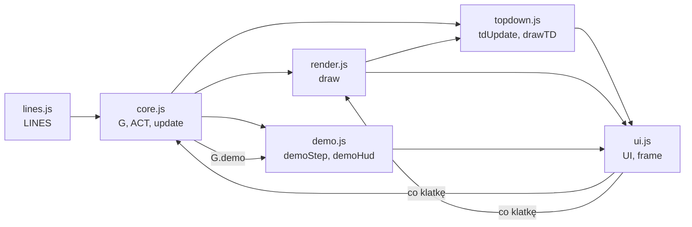
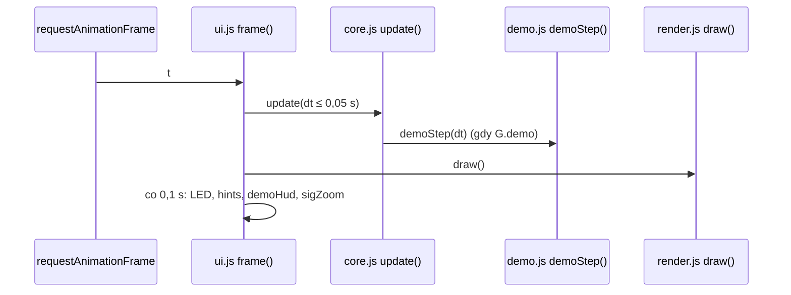

# STiA – Symulator Tramwajów i Autobusów – dokumentacja projektu

Pikselowa gra przeglądarkowa: prowadzisz tramwaj lub autobus MPK Wrocław. Kursy, przystanki i rozkłady pochodzą z prawdziwych danych GTFS, a obsługa odbywa się z panelu kierowcy w stylu IBIS.

---

## 1. Uruchomienie

Wystarczy otworzyć plik `index.html` w przeglądarce (Chrome, Edge lub Firefox). Nie trzeba niczego instalować, budować ani uruchamiać serwera, a gra działa też offline.

| Wymaganie | Wartość |
|---|---|
| Przeglądarka | nowoczesna, z obsługą Canvas 2D, Web Audio i `speechSynthesis` |
| Zależności zewnętrzne | brak (czysty HTML, CSS i JS) |
| Zapis stanu | `localStorage` przeglądarki |

---

## 2. Struktura plików

| Plik | Rozmiar | Rola |
|---|---|---|
| `index.html` | ~39 KB | Szkielet strony, cały CSS, menu startowe, nakładki (`#panel`, `#tasks`, `#sigzoom`, `#demo`, `#minimap`, pasek akcji). Ładuje skrypty w ustalonej kolejności. |
| `lines.js` | ~680 KB | Dane 136 linii (24 tramwajowe, 112 autobusowych) wygenerowane z GTFS MPK: `window.LINES`, w tym odcinki z `shapes.txt` (długość po trasie i skręty). |
| `build_lines.py` | ~5 KB | Narzędzie (Python 3, poza grą): generuje cały `lines.js` z GTFS i na końcu wywołuje `build_segs.py`. Opis w 5.5. |
| `build_segs.py` | ~4 KB | Narzędzie (Python 3, poza grą): dopisuje do `lines.js` pole `seg` (długość po trasie i skręty) na podstawie `shapes.txt` i `trips.txt` z GTFS. |
| `core.js` | ~64 KB | Logika gry: stałe, modele taboru, pogoda, budowa świata, akcje kierowcy, fizyka, punktacja, ruch uliczny. |
| `events.js` | ~28 KB | Ogłoszenia z bazy (osobne dla głośników wewn./zewn./oba), zapowiedzi przystanków, komunikaty dyspozytora (CC), rozmowy RTT/PRTT, wezwanie alarmowe CA i animowane sceny zdarzeń (drzewo, wypadek, służby) jako zadania w trakcie kursu (opis w 4.6). |
| `render.js` | ~92 KB | Rysowanie na canvasie: niebo, budynki, zabytki, ulica, tory, pojazdy 3D, ludzie, pogoda, czcionka pikselowa. |
| `topdown.js` | ~35 KB | Sceny z lotu ptaka: skręt na skrzyżowaniu (mapa się obraca), start na pętli, wjazd przez bramę zajezdni do hali. Ścieżki, mapy offscreen, sprite'y z góry, kamera. |
| `demo.js` | ~14 KB | Pokaz jazdy: autopilot przechodzący misję treningową i nakładka z podpowiedziami klawiszy. |
| `ui.js` | ~47 KB | Panel IBIS, dźwięk, LED, wskazówki, powiększony sygnalizator, minimapa, klawiatura, pętla klatek. |

### Kolejność ładowania skryptów

```
lines.js → core.js → events.js → render.js → topdown.js → demo.js → ui.js
```

Wszystkie pliki współdzielą globalny zakres. `ui.js` musi być ostatni, bo uruchamia pętlę `requestAnimationFrame`. `topdown.js` korzysta z `shade`/`tint` z `render.js` (nie deklaruj ich ponownie).

Znaczniki `<script>` mają parametr wersji (`core.js?v=5`). Po zmianie plików podbij numer – podgląd przeglądarki potrafi trzymać stare skrypty w pamięci podręcznej.



---

## 3. Rozgrywka

### 3.1 Menu startowe

| Klawisz | Karta | Opis |
|---|---|---|
| 1 | Tramwaj | Normalna gra: logowanie, wybór linii i kursu. |
| 2 | Autobus | Jak wyżej, dla autobusu. |
| 3 | Trening – tramwaj | Misja treningowa ze wszystkimi sytuacjami drogowymi. |
| 4 | Trening – autobus | Jak wyżej, dla autobusu. |
| 5 | Pokaz – tramwaj | Gra sama przejeżdża trening i pokazuje, co i kiedy nacisnąć. |
| 6 | Pokaz – autobus | Jak wyżej, dla autobusu. |

Przycisk **⛶** (prawy dolny róg, obok minimapy; obok niego **🔊/🔇** – wyciszenie dźwięku, jak klawisz M), przycisk „⛶ Pełny ekran” w menu lub klawisz **G** przełącza grę na cały ekran (Fullscreen API; wyjście: G lub Esc).

Na ekranie startowym gracz wpisuje **nazwę kierowcy** (wymagana przed jazdą liniową i treningiem, zapamiętywana) i może otworzyć **🏆 Tabelę wyników** (20 najlepszych, z możliwością wyczyszczenia).

W menu ustawia się też **godzinę**, **porę roku**, **pogodę** i **motyw panelu kierowcy**. Puste pole godziny oznacza czas systemowy, a „auto” oznacza porę roku według bieżącego miesiąca. Domyślna pogoda to **„Rzeczywista (Wrocław, na żywo)”** – aktualne warunki i temperatura z Open-Meteo; „Zmienna” to dawna losowa pogoda.

Do menu startowego można wrócić w każdej chwili przyciskiem **⚙ Menu główne** w panelu IBIS (ekran logowania lub menu kierowcy). Bieżący kurs zostaje przerwany (bez kary), a zalogowany kierowca pozostaje zalogowany.

### 3.2 Przebieg kursu

1. **Logowanie** w panelu IBIS numerem służbowym (tabela poniżej).
2. **Wybór linii i kursu** (np. `33` / `05`). Można też wybrać kierunek i obejrzeć podgląd przystanków na linii.
3. **Start ▶**. Pojazd naprawdę stoi na pętli (widok z góry): wyjeżdża z niej łukiem na trasę (pierwszy przystanek jest co najmniej 100 m za wyjazdem z pętli – `LOOP_GAP = 110` w `topdown.js`), potem obraz płynnie przechodzi w widok z boku. Pierwszy odjazd wynika z rozkładu GTFS i aktualnej godziny. Do odjazdu z pierwszego przystanku zegar rozkładu stoi, a wskaźnik pokazuje stałe **−30 s** (30 s przed czasem) – także podczas postoju z otwartymi drzwiami. Czas zaczyna płynąć dopiero po zamknięciu drzwi i odjeździe; taki odjazd nie jest karany jako wczesny i liczy się jako punktualny.
4. **Jazda**: przystanki, sygnalizacja z ulicami poprzecznymi, skrzyżowania, ronda, piesi, zwrotnice, roboty drogowe (zapowiadane znakami) itd. Przy skręcie widok przechodzi z góry: pojazd skręca całym nadwoziem, a mapa obraca się razem z nim.
5. **Pętla końcowa** i **zjazd do zajezdni** (najbliższej geograficznie, np. Gaj, Borek, Ołbin albo Obornicka, Grabiszyńska, Krakowska): przejazd przez bramę z podnoszonym szlabanem (max 10 km/h), wjazd do hali i zatrzymanie na linii STOP przy odbojnicy, zamknięte drzwi.
6. **Podsumowanie** z możliwością przejazdu **kursu powrotnego** w drugą stronę.

| Numer | Kierowca |
|---|---|
| `0000` | Kursant (szkolenie) |
| `1001`–`1005` | Kierowcy regularni |
| `10` | **Kierowca specjalny**: tylko on może wybrać kurs **1/11** (trasa po atrakcjach Wrocławia) |

### 3.3 Sterowanie

| Klawisz | Akcja |
|---|---|
| → / W | Gaz |
| ← / S | Hamulec |
| Spacja / X | Hamulec awaryjny |
| ↑ / ↓ | Zmiana pasa (autobus) |
| Q / A | Kierunkowskaz lewy / prawy |
| E | Drzwi (otwórz / zamknij) |
| R | Rampa dla wózka (pojazdy niskopodłogowe) |
| C / K | Przyklęk (autobus) |
| Z | Zwrotnica (tramwaj) |
| F / P | Piasecznica (tramwaj) |
| D / B | Dzwonek (tramwaj) / klakson (autobus) |
| O | Ekran „Ogłoszenia z bazy” (także przycisk 🔊 w panelu kierowcy); na tym ekranie O zmienia głośniki (wewn. / zewn. / oba – każde mają własną listę 10 ogłoszeń), cyfry 1…0 nadają ogłoszenie |
| V | Potwierdzenie komunikatu dyspozytora |
| F1 | Rozmowa RTT z dyspozytorem (zwykła) – zielony przycisk |
| F2 | Rozmowa PRTT (pilna) – czerwony przycisk |
| F3 | Blokada / odblokowanie kasowników podczas kontroli biletów (bezbarwny przycisk) |
| F4 | Wezwanie alarmowe CA (centrala alarmowa) – magenta |
| M | Wyciszenie dźwięku (także przycisk 🔊/🔇 obok ⛶) |
| Esc | Pauza / wznowienie |
| Mysz / dotyk | Prawa połowa ekranu to gaz, lewa to hamulec (przesunięcie palca na drugą połowę zmienia pedał). Pasek akcji pod panelem kierowcy ma przyciski wszystkich czynności. |

### 3.3.1 Telefony i tablety

Gra sama rozpoznaje urządzenie (`DEV` w `ui.js`) i ustawia na `<body>` klasy `dev-desktop` / `dev-tablet` / `dev-phone`, `touch` oraz `portrait` / `landscape`:

- **Rozpoznanie:** `navigator.userAgentData.mobile`, user-agent (iPhone, Android Mobile, iPad – także iPadOS udający Maca), `pointer:coarse` bez `hover`. Urządzenie dotykowe z krótszym bokiem ekranu < 600 px to smartfon, większe – tablet. Do testów można wymusić typ parametrem `index.html?dev=phone` (albo `tablet`, `desktop`).
- **Skalowanie:** panel kierowcy (z paskiem akcji i F1–F4) jest zmniejszany przez zmienną CSS `--ps` tak, by zajmował najwyżej ok. 56% wysokości i 44% szerokości ekranu telefonu (62% / 52% na tablecie). Na telefonie paski LED, lista zadań, minimapa, powiększone sygnalizatory i menu startowe są mniejsze; uwzględniane są wcięcia ekranu (`env(safe-area-inset-*)`) i `100dvh`.
- **Dotyk:** przyciski akcji są większe i bez podpowiedzi klawiszy, przycisk 📟 chowa/pokazuje panel kierowcy, gaz/hamulec śledzi jeden palec (dotknięcie panelu drugim palcem nie puszcza gazu).
- **Orientacja:** na telefonie w pionie podczas jazdy pojawia się prośba o obrócenie ekranu (przycisk „Graj w pionie” ją ukrywa). Na ekranie startowym urządzenia dotykowe widzą opis sterowania dotykiem i wykryty typ urządzenia.


### 3.4 Zasady i punktacja (wybór)

| Sytuacja | Punkty |
|---|---|
| Precyzja zatrzymania: < 0,5 m / < 1,5 m / < 3 m / < 8 m | +100 / +80 / +55 / +30 |
| Punktualny odjazd (do +90 s) | +50 |
| Odjazd przed czasem (ponad 30 s; nie dotyczy 1. przystanku) | −30 |
| Pominięty przystanek | −100 |
| Pomoc osobie na wózku (wsiadanie / wysiadanie) | +25 / +20 |
| Pozostawienie osoby na wózku | −50 |
| Przyklęk dla seniora / senior wsiada bez przyklęku | +10 / −10 |
| Zamknięcie drzwi przed pasażerami | −20 |
| Kierunkowskaz przy odjeździe (autobus) / brak | +5 / −15 |
| Kierunkowskaz przy skręcie / brak | +15 / −30 |
| Zmiana pasa bez kierunkowskazu | −10 |
| Za szybko w łuku za zwrotnicą lub w skręcie na skrzyżowaniu (> 20 km/h; `TURN_V`, `CURVE_V`) | −30 |
| Za szybko na rondzie (> 30 km/h) | −20 |
| Wymuszenie pierwszeństwa na rondzie / prawidłowy wjazd | −50 / +10 |
| Przejazd na czerwonym | −100 |
| Przekroczenie 50 km/h (co 2 s) | −5 |
| Kolizja | −250 (potrącenie pieszego −350) |
| Płynny skręt (bez przekroczenia 20 km/h) | +20 |
| Ominięty skręt: autobus na złym pasie / tramwaj z nieprzestawioną zwrotnicą (jazda prosto i objazd) | −25 / −40 |
| Ustąpienie pieszemu przy skręcie / nieustąpienie | +15 / −50 |
| Ogłoszenie z bazy na polecenie dyspozytora: właściwe głośniki / złe głośniki / brak w czasie | +40 / +10 / −25 (na pętli −10) |
| Komunikat dyspozytora potwierdzony (V) / niepotwierdzony | +15 / −15 |
| Zgłoszenie RTT (F1) / PRTT (F2) właściwym kanałem | +25 / +35 |
| Sprawa zwykła zgłoszona przez PRTT / pilna przez RTT | +5 / +10 |
| Brak zgłoszenia (RTT 30 s, PRTT 15 s) | −15 / −30 |
| Interwencja służb zakończona (drzwi otwarte dla służb, bez odjazdu) | +20 |
| Minięcie przystanku, na którym czeka policja (agresywny pasażer) | −20 |
| Kasowniki zablokowane (F3) / odblokowane na następnym przystanku | +20 / +20 |
| Odjazd przed wejściem kontrolerów / brak blokady (zdalna blokada) / minięcie przystanku z zablokowanymi kasownikami | −15 / −20 / −20 |
| Wjazd w drzewo na trasie | jak kolizja |
| PRTT bez powodu (poza treningiem) | −10 |
| Wezwanie alarmowe CA w sytuacji alarmowej (po zatrzymaniu) / brak / bez powodu | +40 / −40 / −15 |
| Zjazd do zajezdni / precyzyjne ustawienie w hali (< 1 m od STOP) | +40 / +20 |
| Za szybko na terenie zajezdni (> 10 km/h) / najechanie na odbojnicę | −10 / −60 |

Trzecia kolizja przerywa kurs. Na przystanku drzwi można otworzyć, gdy przód pojazdu jest najwyżej 30% długości za znakiem. Przy większym przejechaniu przystanek nie jest zaliczony.

Po zakończeniu lub przerwaniu kursu (także treningu i wyjściu do menu głównego) wynik trafia do tabeli `localStorage['mpkwro_board']` (`boardAdd()` w `core.js`: nazwa gracza, linia/kurs, pojazd, punkty, kolizje, data; max 100 wpisów, sortowane po punktach). Podsumowanie kursu pokazuje zajęte miejsce, a przycisk „Wyniki” w panelu IBIS – top 10. Przerwane kursy są w tabeli wyszarzone. Pokaz jazdy nie zapisuje wyników. Stara historia per numer służbowy nadal trafia do `mpkwro_scores`.

W oknie tabeli są przyciski **💾 Eksportuj** (pobiera plik `stia-wyniki-RRRR-MM-DD.json`) i **📂 Importuj** (`boardImport()` w `core.js`: łączy wyniki z pliku z obecnymi, bez duplikatów – klucz `ts`+nazwa). Tabela jest zapisana w przeglądarce, więc podmiana plików gry w tym samym folderze jej nie kasuje; eksport/import służy do przeniesienia wyników na inny komputer, do innej przeglądarki lub na wersję gry pod innym adresem.

### 3.5 Warunki zewnętrzne

- **Pora dnia**: kolor nieba, oświetlenie i noc liczone z godzin wschodu i zachodu słońca dla danej pory roku.
- **Pora roku**: zieleń, kolory drzew i śnieg. Jesienią i zimą na torach pojawiają się liście lub lód.
- **Pogoda**: słonecznie, pochmurno, deszcz, burza (błyski i grzmoty), śnieg, mgła. Pogoda zmienia przyczepność (`wxGrip()`), a więc i drogę hamowania.
- **Pogoda rzeczywista** (`ENV.weather = 'live'`, domyślna): `fetchLiveWx()` w `core.js` pobiera z darmowego API [Open-Meteo](https://open-meteo.com) (bez klucza, CORS – działa także z `file://`) bieżący `weather_code` i `temperature_2m` dla Wrocławia (51,11 N, 17,03 E), przy starcie i co 10 minut. Kod WMO → rodzaj pogody (`wmoKind`): 0–1 słonecznie, 2–3 pochmurno, 45/48 mgła, 51–67 i 80–82 deszcz, 71–77 i 85–86 śnieg, 95–99 burza. Zmiana w czasie jazdy przechodzi płynnie. Bez internetu gra używa pogody losowej, a menu pokazuje „brak połączenia”. Meteoblue nie jest używane: strona blokuje zapytania z przeglądarki (CORS), a jej API wymaga płatnego klucza.
- **Panel kierowcy** (motyw): *Klasyczny* (domyślny), *Terminal* ( płaskie kafelki #232323, czarne szczeliny, zielony zegar, niebieskie akcenty), *Pikselarnia* (retro: metalowa deska z nitami, wyświetlacze LED), *Nocny* (czerwone podświetlenie) i *Dzienny* (jasny, wysoki kontrast). Motyw to klasa `pt-*` na `<body>`; style są w `index.html`.

---

## 4. Tryby specjalne

### 4.0 Tryb gry (ekran startowy → „Tryb gry”, zapis w `localStorage['mpkwro_kid']`)

- **⭐ Standardowy** – zwykła gra z punktacją. Wynik nigdy nie spada poniżej 0 (`addScore`: `Math.max(0, …)`).
- **🧸 Dla dzieci (do 6 lat)** – `G.kid = true`, nazwa kierowcy nie jest wymagana. Działa „pomocnik” (`kidStep` w `demo.js`), który używa autopilota z pokazu jazdy (`demoStep`):
  - dziecko może samo jechać i używać wszystkich przycisków; pomocnik ogranicza prędkość i sam hamuje (przystanki, światła, piesi, zwrotnice, służby),
  - pomocnik **nie rusza sam** – jazda tylko, gdy dziecko trzyma gaz; po `KID_IDLE` = 3 s postoju podpowiada „Możesz ruszać – wciśnij Gaz”,
  - każda czynność najpierw jest podpowiadana (nakładka „🧸 POMOCNIK” z klawiszem i odliczaniem ⏳, podświetlony przycisk), a jeśli dziecko jej nie zrobi, pomocnik wykonuje ją sam po czasie z `KID_WAIT` (s): zwrotnica 10, drzwi/rampa/przyklęk/zadania dyspozytora 6, pas 4, kierunkowskaz 3, dzwonek 2,
  - brak punktów (`addScore` pokazuje tylko „★” za dobre akcje), kolizje nie kończą kursu, wynik nie trafia do tabeli ani do `mpkwro_scores`; LED pokazuje 🧸 zamiast PKT.

### 4.1 Misja treningowa (`buildTraining` w `core.js`)

Odcinek o stałym układzie: 6 przystanków od „Plac manewrowy” do „Pętla szkoleniowa”, a na końcu zjazd do zajezdni. Na górze ekranu wyświetlają się wskazówki „TRENING n/6”.

| Odcinek | Tramwaj | Autobus |
|---|---|---|
| start | wyjazd z pętli (widok z góry) | to samo |
| 0 → 1 | przejście dla pieszych | odjazd z kierunkowskazem, przejście, senior (przyklęk) |
| 1 → 2 | liście (piasek), źle ustawiona zwrotnica (Z) | auto przed nami gwałtownie hamuje, znaki A-14, A-12b, B-33 (30), C-10 i roboty drogowe (zmiana pasa) |
| 2 → 3 | czerwone, skręt w lewo (Q + Z) z widokiem z góry i pieszym za zakrętem | skręt w lewo z lewego pasa, czerwone, widok z góry i pieszy za zakrętem |
| 3 → 4 | przejście, rondo z sygnalizatorem tramwajowym | przejście, rondo z ustępowaniem |
| 4 → 5 | skrzyżowanie bez świateł z wymuszeniem, czerwone z ruchem poprzecznym (inne pojazdy też czekają) | to samo |
| 5 → zajezdnia | brama zajezdni, hala, linia STOP | to samo |

Na przystankach 2 i 3 są osoby na wózku (wsiadanie i wysiadanie po rampie).

Zadania dyspozytora w treningu: ogłoszenie (za przyst. 1), komunikat i kontrola biletów (kontrolerzy wsiadają na przyst. 3, kasowniki F3 do przyst. 4), RTT – usterka drzwi, CA – sytuacja alarmowa z przyjazdem służb do drzwi, PRTT – drzewo na trasie.

W widoku skrętu z góry autobus może zmieniać pas (Q/A + ↑/↓), dopóki nie wjechał w skrzyżowanie – tor jazdy przelicza się od bieżącego pasa.

Zadania dyspozytora w treningu (`w.evs` – uruchamiane po minięciu pozycji x, opisane we wskazówkach TRENING 2–5/6):

| x | Zadanie |
|---|---|
| 310 | ogłoszenie „Przesuń się w głąb” (głośniki wewn.) |
| 720 | komunikat dyspozytora – potwierdzenie V |
| 1000 | usterka drzwi – zgłoszenie RTT (F1) |
| 1420 | pasażer potrzebuje pomocy – zatrzymanie i CA (F4) |
| 1520 | przeszkoda na trasie – pilne zgłoszenie PRTT (F2) |
| pętla | ogłoszenie „Przystanek końcowy” |

### 4.2 Pokaz jazdy (`demo.js`)

- `startDemo(mode)` ładuje trening, w razie potrzeby tymczasowo wybiera pojazd niskopodłogowy (`G.demoPrev`) i włącza `G.demo`.
- `demoStep(dt)` (wywoływany z `update`) to autopilot oparty na profilu prędkości:
  - `stopAt(d)`, `slowAt(d, v)` i `cap(v)` wyznaczają prędkość docelową, a gaz i hamulec są sterowane przez `G.keys`;
  - wykonuje zadania dyspozytora: O → (O) → cyfra dla ogłoszeń, V, F1/F2 dla zgłoszeń, zatrzymanie i F4 przy CA (stoi do końca rozmowy z centralą);
  - obsługuje przystanki (drzwi, rampa, przyklęk), światła, zwrotnice, piasek, blokady, ronda, pieszych, skrzyżowania, pasy ruchu, roboty drogowe, wyjazd z pętli (max 14 km/h), skręt z ustąpieniem pieszemu (`tdYield()`) oraz bramę i halę zajezdni (max 9 km/h, zatrzymanie na `depotStopX()`).
- `dPress(...)` wykonuje akcję i pokazuje duży klawisz. Odpowiedni przycisk paska akcji lub panelu F (`.ab` / `.fb`) dostaje klasę `.press`.
- `demoHud()` rysuje nakładkę `#demo`: nagłówek z przyciskiem „Zakończ”, opis bieżącej czynności, wciśnięte klawisze (Gaz, Hamulec, Piasek) i klawisz akcji.
- Podczas pokazu klawiatura jest zablokowana, z wyjątkiem Esc i M.

### 4.3 Kurs specjalny 1/11 – zabytki Wrocławia

- Dostępny tylko dla kierowcy `10`.
- Start spod biurowca (neon „ZABYTKI” na dachu), potem 15 przystanków przy atrakcjach: Tarczyński Arena, Sky Tower, Dworzec Główny, Renoma, NFM, Rynek, Uniwersytet, Hala Targowa, Ostrów Tumski, Panorama Racławicka, Most Grunwaldzki, Hala Stulecia, Ogród Japoński, ZOO.
- Przy każdym przystanku jest zapowiedź z opisem atrakcji i rysunek zabytku (`LANDMARKS` w `render.js`).
- Tarczyński Arena Wrocław (stadion z membranową fasadą, nocą podświetlany na pomarańczowo, zielono i czerwono) jest rysowana na zwykłych liniach przy przystankach „Tarczyński Arena (Lotnicza / Królewiecka / Aleja Śląska)”: linie 3, 10, 18, 20, 21, 101–104, 123, 127, 152, 243, 245 i 253.
- Dane trasy są w `TOUR` (`core.js`) i są wstrzykiwane jako `LINES.OFFICE`.

### 4.4 Powiększona sygnalizacja (`sigZoom` w `ui.js`)

Wszystkie komunikaty o przeszkodach (pieszy, wymuszenie pierwszeństwa, śliskie szyny, roboty), światłach, zwrotnicach, skrętach i rondach pojawiają się najwcześniej **40 m** przed obiektem (stała `AHEAD = 40` w `ui.js`; dotyczy wskazówek i powiększeń, nie autopilota). Informacja o przystanku nadal od 130 m.

Wskazówki są podzielone na dwie grupy (`hints()`):
- **polecenia klawiszy** (np. „Włącz prawy (A) kierunkowskaz”, „Zamknij drzwi (E)”) – lista `#tasks` w lewym górnym rogu;
- **informacje** (przeszkody, przystanek, rondo, objazd, prędkość, pogoda, pętla, zajezdnia) – trafiają do `UI.info` i są rysowane przez `sigZoom()` jako małe ramki pod powiększeniem sygnalizatora (kolor: czerwony – pilne, żółty – uwaga, zielony – przystanek). Widoczne są maks. 4 naraz, najpilniejsze pierwsze.

Na 40 m przed sygnalizatorem w lewym dolnym rogu pojawia się jego powiększenie:

- **sygnalizator tramwajowy**: kreska pozioma, pionowa lub skośna;
- **sygnalizator drogowy**: 3 komory, przy skręcie dodatkowo strzałka;
- opis „JEDŹ / UWAGA / STÓJ” i odległość.

Dla tramwaju pokazuje też stan zwrotnicy (ustawiona i wymagana, „wciśnij Q/A + Z”). Dla autobusu pokazuje kontrolkę skrętu (właściwy pas i kierunkowskaz) oraz – 40 m przed robotami – ramkę „ROBOTY DROGOWE” ze znakiem A-14 i podpowiedzią „Q + ↑ na lewy pas, za robotami A + ↓”.

### 4.5 Sceny z lotu ptaka (`topdown.js`)

Trzy sytuacje są pokazywane z góry, z kamerą obróconą tak, by kierunek jazdy był zawsze w prawo – przy skręcie obraca się więc cała mapa:

| Scena | Start | Co się dzieje |
|---|---|---|
| `tdLoop` – pętla | `loadTrip` / `loadTraining` → `tdStartLoop()` | Pojazd stoi na pętli i wyjeżdża łukiem na trasę; limit 15 km/h. Scena kończy się `LOOP_GAP` (110 m) przed pierwszym przystankiem. |
| `tdTurn` – skręt | 40 m przed sygnalizatorem skrętu | Skrzyżowanie z pasami, autami i przejściem za zakrętem; pieszy wchodzi na pasy, trzeba ustąpić. +20 za płynny skręt. Pojazd skręca sam; decyzja zapada na linii zatrzymania. Autobus musi stać na właściwym pasie (lewy – w lewo, prawy – w prawo), tramwaj mieć przestawioną zwrotnicę (Q/A + Z). Inaczej jedzie prosto bez wykolejenia („NA WPROST – OBJAZD”, autobus −25, tramwaj −40): `turnMissed` odsuwa resztę trasy o `DETOUR` = 200 m (`shiftWorld`) i dodaje skręt „OBJAZD” w tę samą stronę na następnym skrzyżowaniu. Ominięcie objazdu powtarza tę procedurę. |
| `tdDepot` – zajezdnia | 30 m przed bramą przy zjeździe | Brama ze szlabanem, plac, hala ze stanowiskami, linia STOP i odbojnica; koniec kursu po zatrzymaniu z zamkniętymi drzwiami. |

Scena jest opisana ścieżką (`mkPath`: odcinki proste i łuki, metry; `TS = 3` px/m). Postęp `T.s` jest powiązany z `G.veh.x` (`x0 + s`), więc fizyka, punktacja i autopilot działają bez zmian. `tdUpdate(dt)` uruchamia i kończy sceny (przenikanie przez `T.a`), `drawTD(T)` rysuje mapę offscreen, pojazdy z góry (sekcje przegubowe, kierunkowskazy, światła stopu), pieszych, sygnalizator, noc, reflektory i pogodę.

---

### 4.6 Ogłoszenia, komunikaty i rozmowy (`events.js`)

Ikony nad kabiną rysują `drawAnnGroup`/`drawCallIcon` w `render.js`. Rysuje je `draw()` po nocnym przyciemnieniu, a przed pogodą, w miejscu `G._callAt` nad przodem własnego pojazdu. W scenach z lotu ptaka ikon nie ma.

- **Zapowiedź przystanku**: każda automatyczna zapowiedź (`annStop`: „Następny przystanek…”, „Przystanek…”, zjazd do zajezdni) mówi głosem i na 4 s pokazuje niebieską ikonę głośnika (`stop`).
- **Ogłoszenia z bazy**: przycisk 🔊 w panelu kierowcy (miga, gdy dyspozytor zleca ogłoszenie) lub klawisz O. Na ekranie wybiera się głośniki – zakładki pokazują tylko ikony (`annIconURL('int'|'ext'|'both')`, bez napisów), a każde głośniki mają własną bazę 10 ogłoszeń (`ANN_DB.int/ext/both`):
  - *wewnętrzne* (do pasażerów): przesuń się w głąb, bilet, kasowanie, bagaż, ustąp miejsca, trzymaj się, jedzenie, przepraszamy za opóźnienie, awaria pojazdu, przystanek końcowy;
  - *zewnętrzne* (na przystanek): linia i kierunek (dynamicznie), odsuń się od krawędzi, wsiadaj sprawnie, wsiadanie przednimi drzwiami, pojazd pełny – następny za chwilę, kurs zjazdowy, rower, wózek dziecięcy, przejazd techniczny;
  - *oba*: zamykanie drzwi, odjazd, objazd, wstrzymanie ruchu, zachowaj spokój, ewakuacja, kieszonkowcy, ślisko, pomoc dla pasażera, dziękujemy.
  Ogłoszenie jest czytane głosem, a nad kabiną pojawia się ikona `int` / `ext` / `both`. Polecenia dyspozytora (`ANN_REQ`, 18 sytuacji) wskazują ogłoszenie i głośniki.
- **Panel F** (`.fbar`, `UI.fbarH()`/`UI.fbar()`): pionowy pasek po prawej stronie panelu kierowcy z przyciskami F1 RTT (zielony), F2 PRTT (czerwony), F3 KASOW. (żółty, blokada kasowników), F4 CA (magenta) – definicja w `FKEYS`. Trwająca rozmowa podświetla swój przycisk (`.on`), a przycisk wymagany przez zadanie miga (w kursie liniowym przy zgłoszeniu migają F1 i F2 – kierowca sam decyduje, czy sprawa jest pilna).
- **Rozmowy wywołuje kierowca** (`evCall('rtt'|'prtt')`, `evAlarm()`): oczekiwanie na zgłoszenie dyspozytora (sygnał zwrotny, kropki), kierowca mówi (kropki w górę), dyspozytor odpowiada głosem (kropki w dół, odpowiedź trafia do skrzynki). CA: kroki 1 → 2 → rozmowa z centralą; przy prawdziwej sytuacji alarmowej trzeba najpierw stanąć.
- **Zadania dyspozytora** – zawsze jedno naraz, kolejne najwcześniej 6 s po poprzednim. Miejsca zadań leżą w `w.evs`: w treningu i pokazie stałe, a w kursie liniowym losuje je `evPlan()` (wywoływane w `loadTrip`) – **na każdej linii zawsze: ogłoszenie, komunikat, RTT, PRTT, CA i kontrola biletów**; na trasach > 2,5 km dochodzi drugie RTT, PRTT i CA, a > 5 km drugie ogłoszenie i komunikat. Zadania leżą w losowej kolejności na 85 % trasy, a `w.evUsed` pilnuje, by zgłoszenia i sytuacje alarmowe na jednym kursie się nie powtarzały (różne formy):
  - *polecenie ogłoszenia* – wiadomość w skrzynce i ikona `ccDrv`; trzeba nadać wskazane ogłoszenie na wskazane głośniki w 45 s; przy opóźnieniu > 2 min jest to „Przepraszamy za opóźnienie”. Na przystanku końcowym zawsze: „Przystanek końcowy” (25 s);
  - *komunikat CC* – dyspozytor mówi do kierowcy (`ccDrv`) lub do pasażerów (`ccDrv`+`ccPass`); potwierdzenie V w 18 s;
  - *zgłoszenie* (`REPORTS`) – usterka lub utrudnienie (drzwi, kasownik, korek, klimatyzacja → RTT F1 w 30 s) albo sprawa pilna (agresywny pasażer, drzewo na trasie, wypadek → PRTT F2 w 15 s);
  - *sytuacja alarmowa* (`EMERG`: zasłabnięcie, bójka, dym w pojeździe, upadek pasażera) – trzeba się zatrzymać, nacisnąć F4 w 35 s i poczekać na służby;
  - *kontrola biletów* (`G.ctrl`, `ctrlStart`/`updateCtrl`/`ctrlKey`/`drawCtrl`) – dwóch kontrolerów (żółte identyfikatory) czeka na wskazanym przystanku i wsiada najbliższymi drzwiami (drzwi nie zamkną się, dopóki wsiadają). Po zamknięciu drzwi trzeba zablokować kasowniki F3 (25 s, inaczej −20 i zdalna blokada dyspozytora). Nad kabiną świeci ikona zablokowanego kasownika (`drawKasIcon`). Odblokować można dopiero na kolejnym przystanku, na postoju i **przed otwarciem drzwi** – do tego czasu drzwi się nie otworzą; potem kontrolerzy wysiadają.
- **Animacje zdarzeń** (`G.evFx`, `fxAdd` / `updateFx` / `drawEvFx(0|1)` w `events.js`; warstwa 0 – drugi pas, warstwa 1 – przed pojazdem i nad nim). `res` to sekundy od wykonania zadania (zgłoszenia / CA):
  - *drzwi* – migające, iskrzące drzwi; *kasownik*, *klimatyzacja* – dymek nad pojazdem; znikają po zgłoszeniu;
  - *korek* – sznur hamujących aut na sąsiednim pasie (autobus) albo na jezdni dalszej (tramwaj – nigdy na torze przeciwnym; `jamBlocks()`, auta na tym pasie ustawiają się za korkiem);
  - *drzewo* – leży w poprzek trasy ok. 40–110 m przed pojazdem (dystans zależy od prędkości, nie na skręcie/rondzie/zjeździe) i blokuje przejazd (wjazd = kolizja); po zgłoszeniu przyjeżdża pomarańczowa ekipa, pracownicy tną pień (iskry), po ok. 10 s droga jest wolna;
  - *wypadek* – dwa rozbite auta na sąsiednim pasie (dym, światła awaryjne), potem policja i karetka; autobus nie wjedzie na ten pas;
  - *agresywny pasażer* – dymek „#@!” nad pojazdem; dyspozytor każe stanąć na najbliższym przystanku i czekać na policję **z zamkniętymi drzwiami**;
  - *zasłabnięcie / upadek* (karetka), *bójka* (policja), *dym* (straż).
  - **Interakcja ze służbami** (`o.svc`, `svcStart`/`updateSvc`/`drawCrew`/`evDoorGate`/`evThrBlock`): po zatrzymaniu radiowóz / karetka / wóz straży podjeżdża na planszy przed pojazd, załoga podchodzi do najbliższych drzwi (stany wait → come → walk → door → in → out → go → done). Do przyjazdu służb drzwi nie dają się otworzyć, a pojazd nie ruszy. Gdy załoga stoi przy drzwiach (dymek „E”), kierowca otwiera drzwi (poza przystankiem – awaryjne otwarcie); załoga wchodzi, ratownicy wynoszą pasażera na noszach, policja wyprowadza zatrzymanego. W tym czasie nie da się zamknąć drzwi. Po odjeździe służb (+20) zamyka się drzwi i jedzie dalej.
  Pojazdy służb, rozbite auta i ekipa od drzewa zajmują drugi pas (autobus) lub przeciwny tor (tramwaj) – `svcBlocks()` w `events.js`. Samochody na tym pasie (`updateCars`) i tramwaje z naprzeciwka (`moveTraffic`) stają przed nimi i ruszają dopiero, gdy służby odjadą; nowy ruch nie pojawia się w zajętym miejscu.
  Autopilot pokazu staje przed drzewem, czeka na służby z zamkniętymi drzwiami, otwiera im drzwi, a przy kontroli blokuje i odblokowuje kasowniki F3.
- Polecenia klawiszy trafiają do `#tasks`, a stan (kto dzwoni, treść komunikatu) do ramek pod sygnalizatorem (`evHints` wywoływane z `hints()`). Podsumowanie kursu pokazuje „Zadania dyspozytora: wykonane/wszystkie”.
- Stan: `G.ann`, `G.annT`, `G.call`, `G.callSeq` (kolejne fazy rozmowy), `G.evTask`, `G.evT` (przerwa do kolejnego zadania), `G.evFx` (animowane sceny); zerowane w `resetRun`. `updateEvents(dt)` działa w `update()` tylko podczas jazdy (pauza wstrzymuje zadania).

---

## 5. Architektura kodu

### 5.1 Stan globalny (`core.js`)

| Obiekt | Zawartość |
|---|---|
| `G` | Stan gry: `mode`, `driver`, `trip`, `world`, `veh`, `ns` (indeks następnego przystanku), `running/paused/ended`, `simTime`, `score`, `log`, `stats`, `keys`, `model`, `demo`, `toDepot`, `inDepot`. |
| `G.world` | Świat kursu: `stops`, `signals`, `switches`, `turns`, `rounds`, `junctions`, `crossings`, `cars`, `works`, `leaves`, `blockers`, `walkers`, `dwarfs`, `loopA/loopB`, `depot`, `tips`. |
| `G.veh` | Pojazd gracza: `x` (m), `v` (m/s), `doors`, `ramp`, `kneel`, `ind`, `lane/ly`, `sand`, `lock` i inne. |
| `VEH[mode]` | Parametry aktualnego modelu (kopia z `MODELS`): długość, przyspieszenie, hamowanie, drzwi, wygląd. |
| `ENV`, `WX`, `LIVE` | Ustawienia godziny, pory roku i pogody, bieżąca pogoda oraz ostatni odczyt pogody rzeczywistej (Open-Meteo). |
| `ACT` | Akcje kierowcy: `doors`, `ramp`, `kneel`, `ind`, `bell`, `sw`, `sand`, `lane`. |

Stałe skali: `PX = 3` (piksele na metr), `TIME_SCALE = 2` (czas symulacji biegnie 2× szybciej), `LIMIT = 50 km/h`.

**Odległości i skręty z prawdziwych tras.** Każdy odcinek ma w `lines.js` swoją długość mierzoną wzdłuż trasy z GTFS `shapes.txt` oraz listę miejsc, w których trasa skręca. `segLayout` w `core.js` (stałe `SEG`) skraca odcinek, żeby jazda nie trwała za długo:

| Długość rzeczywista | Długość w grze |
|---|---|
| do 1000 m | 160 m + 45% nadwyżki ponad 160 m (np. 463 m → ok. 300 m) |
| ponad 1000 m | 538 m + 15% nadwyżki ponad 1000 m, max 700 m |

Skręty leżą w tym samym miejscu odcinka (ułamek długości) co w rzeczywistości, ale co najmniej 80 m za przystankiem, 120 m przed następnym i 130 m od siebie. Gdy skrętów jest za dużo, odcinek wydłuża się do 820 m, a potem odpadają najłagodniejsze. W odcinkach ze skrętami nie losuje się rond, zwrotnic ani przejść. Bez danych `seg` (np. trasa kursu 1/11) działa stary sposób: `DIST_SCALE = 0.5` z odległości w linii prostej (150–620 m) i `turnDir` z trzech kolejnych przystanków.

### 5.2 Najważniejsze funkcje

| Funkcja | Plik | Opis |
|---|---|---|
| `buildWorld(cfg)` | core | Generuje świat linii z danych GTFS (deterministycznie z ziarna `linia/kurs`). |
| `buildTraining(w, mode, R)` | core | Stały układ misji treningowej. |
| `makeTrip`, `loadTrip`, `loadTraining`, `loadIdle` | core | Tworzenie i ładowanie kursu. |
| `update(dt)` | core | Krok symulacji: fizyka, przystanki, sygnały, zwrotnice, skręty, ronda, ruch uliczny, kolizje. |
| `arrive`, `depart`, `exchange`, `startDepot`, `endTrip` | core | Cykl przystanku i koniec kursu. |
| `updateJunction`, `updateRound`, `updateCars`, `updateCrossing` | core | Ruch innych uczestników. |
| `obstAhead`, `moveTraffic`, `updateDeco` | core | Ruch pozostałych pojazdów: osobne pasy (`ly`), odstępy, zatrzymanie na czerwonym, przed pieszymi i autami poprzecznymi. |
| `tdUpdate`, `drawTD`, `tdStartLoop`, `depotStopX` | topdown | Sceny z lotu ptaka (pętla, skręt, zajezdnia). |
| `vehCurved`, `drawCrossSt`, `worksSigns` | render | Ostry łuk pojazdu (przesunięcie kolumn pikseli), ulica poprzeczna przy sygnalizacji, znaki przed robotami. |
| `setModel(id)` | core | Zmiana modelu pojazdu (zapis w `localStorage['mpkwro_model']`). |
| `draw()` | render | Rysuje całą klatkę (warstwy od tła do pierwszego planu). |
| `tramSprite`, `busSprite` | render | Pojazdy w lekkim 3D z obracającymi się kołami. |
| `ptext` | render | Czcionka pikselowa z polskimi znakami. |
| `UI.setPanel`, `UI.render`, `UI.act` | ui | Panel IBIS (stany: `off`, `login`, `menu`, `linekurs`, `route`, `trip`, `veh`, `train`, `scores`, `msgs`, `info`, `help`). |
| `hints()`, `updateLeds()`, `sigZoom()`, `drawMinimap()` | ui | Elementy HUD. |
| `DEV.detect`, `DEV.apply` | ui | Rozpoznanie komputer/tablet/smartfon, klasy `dev-*`/`touch`/`portrait` na `<body>` i skala panelu `--ps`. |
| `frame(t)` | ui | Główna pętla: `update` + `draw` co klatkę, HUD co 0,1 s, minimapa co 0,3 s. |

### 5.3 Pętla gry



### 5.4 Ruch uliczny

- **Pozostałe pojazdy** (`G.far`, `G.oppo`) jadą po osobnych pasach (`ly` 123 / 133 na dalszej jezdni, 155 tramwaj z naprzeciwka). Nowy pojazd pojawia się tylko, gdy pas jest wolny (`trafficFree`), a w ruchu trzyma odstęp od poprzednika.
- `obstAhead(front, dir, y0, y1)` zwraca odległość do najbliższej przeszkody: czerwone/żółte światło, pieszy na przejściu, auto przecinające jezdnię na skrzyżowaniu. Korzystają z niej `moveTraffic` (pozostałe pojazdy) i `updateCars` (auta na naszej jezdni).
- **Skrzyżowania bez świateł**: auta jadą dwiema kolumnami (w dół lewą, w górę prawą), nie pojawiają się na zajętej kolumnie i zwalniają za poprzednikiem.
- **Ulice poprzeczne** (skrzyżowania bez świateł i zwykła sygnalizacja, `updateJunction`/`allJ`/`sigJ` w `core.js`) są tylko po bliższej stronie – nie ma wyjazdów z budynków. Auta z obu pasów jezdni dalszej skręcają w nie z migającym kierunkowskazem (`farTurn`), zjeżdżają z jezdni i czekają przed torami (`XSTOP_DN`). Na czerwonym stoją przed sygnalizatorem, a bez świateł ustępują tramwajowi/autobusowi i tramwajowi z naprzeciwka (`oppoNear`). Auta z ulicy poprzecznej wjeżdżają na tory tylko na swoim zielonym (`crossGreen`) albo gdy nic nie nadjeżdża, a potem włączają się do ruchu na jezdni dalszej (`XEXIT`).
- **Prześwity ulic** (`streetGap` w `render.js`) zostały tylko przy dużych skrzyżowaniach ze skrętem, gdzie pojazd skręca w górną ulicę.

### 5.5 Dane GTFS (`lines.js`)

Format:

```js
window.LINES = {
  "33": { type: "tram" | "bus", dirs: [
    { head: "KIERUNEK",
      stops: [[nazwa, lat, lon, minutaOdStartu], ...],
      deps:  [minutaDobyOdjazdu, ...],
      shape: [[lat, lon], ...],     // do minimapy (uproszczony)
      seg:   [[długośćM, [[ułamek, kierunek, kąt], ...]], ...] }, // odcinek i → i+1; kierunek 1 = w lewo, -1 = w prawo
    { ... drugi kierunek ... }
  ]}
};
```

Źródło: Otwarte Dane Wrocław, GTFS MPK (feed opublikowany 04.11.2026, ważny 07–22.11.2026), dzień roboczy wtorek 10.11.2026. Pierwsza linia `lines.js` zawiera okres ważności i dzień obsługi.

#### Odświeżanie danych

Wymagany jest tylko Python 3 (bez dodatkowych pakietów). Pełne przeliczenie trwa ok. 30 s.

```powershell
curl.exe -L -o gtfs.zip https://open-data.cui.wroclaw.pl/hdb/download/160/
Expand-Archive gtfs.zip gtfs
python build_lines.py gtfs lines.js            # pierwszy wtorek z okresu ważności (od dziś)
python build_lines.py gtfs lines.js 20261110   # albo konkretny dzień RRRRMMDD
```

Link z wroclaw.pl/open-data zwraca błąd 403, dlatego używany jest bezpośredni adres portalu open-data.cui.wroclaw.pl. Po wygenerowaniu podbij `?v=N` w `index.html` i sprawdź grę (rozdział 7).

`build_lines.py`:

| Krok | Reguła |
|---|---|
| Dzień obsługi | `calendar.txt` (dzień tygodnia i zakres dat) z wyjątkami z `calendar_dates.txt`. |
| Typ linii | `route_type` 0 = tramwaj, 3 = autobus; inne typy są pomijane. |
| Kierunki | Według `direction_id`. Linia jednokierunkowa (np. 240, 345) dostaje kopię kierunku jako drugi. |
| Trasa kierunku | Najczęstszy wariant przystanków danego dnia z pominięciem zjazdów do i z zajezdni. |
| Minuty przy przystankach | Z kursu tego wariantu najbliższego południa. |
| Odjazdy (`deps`) | Wszystkie kursy kierunku zaczynające się na tym samym przystanku początkowym (minuta doby). |
| `shape` (minimapa) | Kształt kursu wzorcowego uproszczony algorytmem Douglasa–Peuckera (eps 0,00025°). |
| Kolejność linii | Tramwaje (< 100), potem linie literowe, potem autobusy numerycznie. |

`build_segs.py` dla każdego kierunku wybiera kształt (`shape_id`) linii, do którego przystanki pasują najlepiej, i rzutuje na niego przystanki po kolei. Skręt to zmiana kierunku o 40–150° mierzona na ramionach 20 m (kąt końcowy na 35 m), z odstępem co najmniej 45 m. Mniejsze kąty to łuki ulicy, a większe to zawracanie – żadne z nich nie jest skrętem.

### 5.6 Klucze `localStorage`

| Klucz | Zawartość |
|---|---|
| `mpkwro_model` | Wybrany model tramwaju i autobusu. |
| `mpkwro_scores` | Historia wyników dla każdego kierowcy. |
| `mpkwro_board` | Tabela wyników (nazwa gracza, linia, pojazd, punkty, kolizje, data). |
| `mpkwro_player` | Nazwa kierowcy wpisana na ekranie startowym. |
| `mpkwro_kid` | Tryb gry: `1` = dla dzieci, `0` = standardowy. |
| `ibisEnv` | Ustawiona godzina, pora roku i pogoda (`live`, `auto` lub stały rodzaj; `wv` – wersja ustawień, stare „auto” jest jednorazowo zamieniane na `live`). |
| `ibisPanel` | Wybrany motyw panelu kierowcy (`classic`, `trap`, `piks`, `night`, `day`). |

---

## 6. Tabor

| Tramwaje | Autobusy |
|---|---|
| Moderus Gamma, Pesa Twist 146N, Škoda 16T, Škoda 19T, Protram 205 WrAs (niskopodłogowe) | Solaris Urbino 12 i 18, Mercedes Citaro G, eCitaro, Volvo 7700 |
| Konstal 105Na, 105N2k/2000, Protram 204 WrAs (składy dwuwagonowe, wysoka podłoga – brak rampy) | |

Pojazdy są wizualnie wydłużone (`LEN_K = 1.45`), a prawdziwa długość jest w `m.m`. Model wybiera się w panelu IBIS (ikona pojazdu).

---

## 7. Rozwój i testowanie

- **Sprawdzanie składni**: `node --check core.js` (i analogicznie dla pozostałych plików).
- **Test danych linii** (po odświeżeniu GTFS): w konsoli przeglądarki wczytaj każdy kierunek każdej linii.

  ```js
  G.driver = { id: '1001', name: 'Test' };
  for (const ln of Object.keys(LINES)) if (ln !== 'OFFICE') LINES[ln].dirs.forEach((D, di) => { loadTrip(makeTrip(ln, 1, di, 480)); for (let i = 0; i < 120; i++) update(1 / 60); });
  ```

  Brak wyjątków oznacza poprawny format. Linia `OFFICE` jest wewnętrzną trasą kursu 1/11 i nie wybiera się jej jako zwykłej linii.
- **Szybki test w konsoli przeglądarki**: przejazd pokazu bez renderowania.

  ```js
  document.getElementById('start').classList.add('hide');
  startDemo('bus');
  for (let i = 0; i < 60 * 700 && !G.ended; i++) update(1 / 60);
  console.log(G.ended, G.score, G.log.filter(l => l.p < 0));
  ```

  Pokaz jest regresyjnym testem logiki gry. Poprawny przejazd kończy się w hali zajezdni („Kurs zakończony – pojazd w hali zajezdni”) bez ujemnych punktów (tramwaj i autobus ok. 710–715 pkt).
- **Dodanie nowej sytuacji drogowej**:
  1. Dodaj obiekt do `G.world` w `buildWorld` i `buildTraining`.
  2. Dodaj obsługę w `update`, rysowanie w `draw`, wskazówkę w `hints` i reakcję autopilota w `demoStep`.
- **Zasady**: wszystko działa bez serwera. Nie dodawaj zależności zewnętrznych ani modułów ES, bo `file://` blokuje importy.

---

## 8. Znane ograniczenia

- Świat jest jednowymiarowy (jazda w osi X). Skręty, pętle i zajezdnia są pokazywane w scenach z góry, a ronda i łuki zwrotnic – z boku.
- Odległości między przystankami są skrócone (`SEG` w `core.js`), a rozkład dotyczy tylko jednego dnia roboczego.
- Ronda są losowe (nie wynikają z kształtu trasy), a łagodne łuki ulic (< 40°) i zawracanie (> 150°) nie są odwzorowywane.
- Autopilot (`demo.js`) jest dostrojony do placu treningowego; na prawdziwych liniach autobus czasem zostaje na lewym pasie.
- Na wąskich ekranach (< 760 px) nakładki są zmniejszane, a lista zadań jest ukryta podczas pokazu. Na telefonie najwygodniej grać poziomo; awaryjne hamowanie (Spacja) i klawisze ogłoszeń 1–9 nie mają osobnych przycisków dotykowych (ogłoszenia są w panelu 🔈).
- Głos zapowiedzi zależy od dostępności polskiego głosu w `speechSynthesis` systemu.
